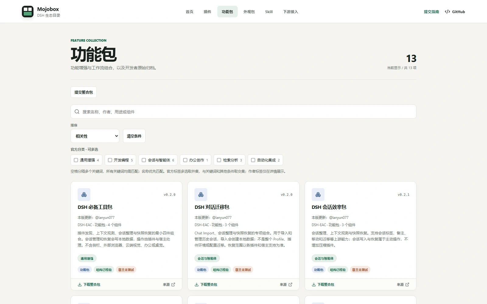

<h1 align="center">
  
</h1>

<p align="center">发现、下载和分享 DeepSeek Harness 的插件、功能包与外观包。</p>

<p align="center">
  <a href="https://mojobox.cn/">浏览网站</a> ·
  <a href="#从这里开始">快速使用</a> ·
  <a href="#提交资源">提交资源</a> ·
  <a href="https://github.com/lanyun077/Mojobox-Installer">安装器</a> ·
  <a href="docs/development.md">开发文档</a>
</p>

## 从这里开始



1. 在 [mojobox.cn](https://mojobox.cn/) 搜索资源，按分类、标签、时间或热度筛选。
2. 打开详情，查看介绍、预览、作者、版本与安装要求。
3. 下载文件，或使用 [Mojobox Installer](https://github.com/lanyun077/Mojobox-Installer#安装) 在客户端中安装整合包。

| 分类 | 内容 |
| --- | --- |
| [插件](https://mojobox.cn/#/plugins) | 单个工具、模型接入和客户端扩展 |
| [功能包](https://mojobox.cn/#/packs) | 功能增强与工作流插件组合 |
| [外观包](https://mojobox.cn/#/skins) | 皮肤、主题与界面外观组合 |

使用技巧见[搜索与筛选](docs/catalog-search.md)。

当前提供 6 个功能包与 5 个外观包，覆盖日常开发、综合研究、文档办公、人设记忆、移动会话、
对话迁移及主题定制。2026-11-21 更新的组件版本与用途见[整合包更新](docs/catalog-update-20261121.md)。

## 提交资源

1. 准备资源介绍、作者、版本、许可与来源链接。
2. 按资源类型添加文件，向本仓库提交 PR。
3. 审核通过后，资源随网站发布展示。

| 资源 | 提交材料 | 指南 |
| --- | --- | --- |
| 插件 | JSON 信息卡；提供下载时附原始 `.tgz` | [插件投稿](docs/plugin-intake.md) |
| 功能包、外观包 | `.dshpack` 文件与同 ID 收录记录 | [整合包制作](docs/author-pack-request.md) · [投稿规范](docs/intake.md) |

[完整投稿步骤](docs/community-submissions.md) · [分类与标签](docs/catalog-tags.md) · [推荐资源或咨询](https://github.com/lanyun077/EAC-mojobox/issues/new?template=package-submission.yml)

## 下游接入

插件索引：

```text
https://mojobox.cn/generated/api/v1/plugins.json
```

功能包与外观包目录：

```text
https://mojobox.cn/generated/catalog.json
```

[插件接口文档](docs/plugin-source-api-v1.md)提供字段、Schema 和下载校验说明；整合包通过 `metadata.category` 区分类型。

## 开发与验证

使用 Node.js 22.12 或更新的受支持版本：

```bash
git clone https://github.com/lanyun077/EAC-mojobox.git
cd EAC-mojobox
npm ci
npm run dev
```

构建、测试、仓库结构和部署见[开发文档](docs/development.md)，提交代码见[贡献指南](CONTRIBUTING.md)。

## 反馈与许可

资源纠错或来源失效请[提交 Issue](https://github.com/lanyun077/EAC-mojobox/issues)；安装问题请到[安装器仓库](https://github.com/lanyun077/Mojobox-Installer/issues)反馈。

项目代码采用 [MIT](LICENSE)。第三方插件、整合包和素材遵循各自的许可与署名。网站数据使用见[隐私说明](docs/privacy.md)。
