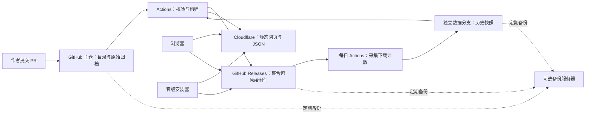

# GitHub＋Cloudflare 静态部署方案 V2

日期：2026-11-14。2026-11-16 更新：静态改造已进入发布流程，平台配置由维护者完成；
发布状态与实际验证见[静态站发布说明](static-cloud-release.md)和 Actions，官版联动另行验收。

本方案取代 V1 中面向 ECS 的 FastAPI、PostgreSQL、OAuth 和点击统计部署计划。
取消网站登录；保留浏览、搜索、详情、官方标签筛选、投稿者署名、时间排序、下载排行及安装器接入。
正式网站沿用已有 Cloudflare Workers 静态资产入口，不再按旧文档新建 Pages 项目。
域名计划以 `https://mojobox.cn` 为正式入口，`www` 跳转到根域名。

## 1. 架构与边界

- Mojobox 主仓继续是目录、标签、收录和原始归档的事实源，Releases 只是相同字节的分发副本。
- Cloudflare 只托管静态文件；不增加 Workers API、D1、KV 或账号服务。
- GitHub 负责附件下载计数。网站不再建立用户会话，不上报下载点击，不收集用户安装记录。
- 投稿和问题反馈跳转 GitHub；这些操作使用 GitHub 自己的登录。
- 安装与更新仍由独立的 Mojobox Installer 在用户本机执行，不改变包格式、安装授权和配置保护规则。
- 朋友的大陆服务器不承担公开网站、登录、统计或下载服务，仅在后续用于主动拉取备份。
- 境外托管与域名绑定不替代内容许可、隐私和平台使用规则；不配置大陆公开 API 或大陆 CDN 接入。

## 2. 需要你亲自操作的部分

平台账号、域名和密钥由你管理。以下是改造完成后的目标配置，旧工作流目前还不能直接使用这些新变量。

### A. Cloudflare 与域名

1. 保留已有 `mojobox` Workers 静态站，确认其所属 Cloudflare 账户和准确 Worker 名称，不重复创建站点。
2. 在 Cloudflare 添加 `mojobox.cn`；如尚未使用 Cloudflare DNS，先记录现有 DNS，再在注册商处切换到 Cloudflare 提供的 NS。
   保留邮箱等已有记录，不能直接清空 DNS。
3. 为现有 Worker 添加自定义域 `mojobox.cn`，等待域名与 HTTPS 证书生效。按控制台自定义域流程配置，不手工猜测 Workers 的 IP。
4. 配置 `www.mojobox.cn` 到 `https://mojobox.cn` 的永久跳转，保留路径与查询参数；确认不会形成循环。
5. 创建专用于 GitHub 发布的 Cloudflare API Token，可从 Workers 编辑模板开始，限定目标账户；
   以实际 Wrangler 部署所需权限为准，不使用 Global API Key。DNS 由控制台配置，不为部署额外授予 DNS 修改权限。
6. 代码改造完成后，将现有自动构建或手动上传入口停用，统一由 Actions 发布，避免两条发布链互相覆盖。

验收：根域名 HTTPS 正常，`www` 正确跳转，目录和深链接能打开，旧预览地址仍可用于核对。

### B. GitHub 配置

在主仓建立或复用 `cloudflare-production` environment，仅允许正式 `main` 分支发布。
将以下值配置在该 environment；密钥直接填入 GitHub，不发送到聊天或写入源码。

| 配置名 | 类型 | 目标值或用途 |
| --- | --- | --- |
| `CLOUDFLARE_API_TOKEN` | Secret | 专用部署 Token |
| `CLOUDFLARE_ACCOUNT_ID` | Variable | 现有 Worker 所属账户 ID |
| `CLOUDFLARE_WORKER_NAME` | Variable | 现有 Worker 的准确名称 |
| `MOJOBOX_SITE_ORIGIN` | Variable | `https://mojobox.cn` |

现有仓库 Variable `MOJOBOX_STATIC_HOST` 保留，但最后切换时才设为 `cloudflare`。
`MOJOBOX_API_ORIGIN` 和 `VITE_API_ORIGIN` 不再使用；等代码移除依赖后清除旧配置。

还需要你完成：

- 确认主仓保持公开，GitHub Actions 可用，仓库规则允许指定受信任务发布 Releases、写入统计数据分支。
  不需要因此放开所有工作流的写权限；具体 job 权限由代码限定。
- 保留现有 PR 检查与审核门禁；统计分支不作为代码合并入口，也不触发新的代码发布循环。
- 取消本项目旧 OAuth App，或先停用并撤销不再需要的 Secret；不把旧回调迁移到静态网页。
- 在我交付代码并完成验证后，授权推送、合并与首发；配置就绪后手动运行一次正式工作流。
- 从你的国内网络验证网站、GitHub 附件下载和官版安装器；记录网页与下载各自是否可达。

验收：Actions 能发布到正确 Worker，正式域名显示预期版本，测试下载有计数，下一次采集能反映增量。

### C. 服务器备份，可在上线后安排

不需要安装 PostgreSQL。需要你或服务器所有者提供专用备份目录、磁盘额度和受限系统账号，
确认服务器使用授权。备份任务主动向 GitHub 拉取，网站不连接这台服务器，也不开公开备份 API。

备份内容包括：主仓完整 Git 历史与统计分支、Release 附件及其映射清单。
如果需要完整恢复项目协作记录，再通过 GitHub API 导出 Issues／PR 元数据；单纯 Git clone 不含这些信息或附件。
Cloudflare 配置说明和域名记录另外保存，Token 只在个人密码管理器保管，不混入普通备份。

先每天备份、保留最近 7 份成功快照；按实际附件体积调整容量。
不要用会同步删除历史文件的单一镜像替代版本备份，也不每天重复下载未变化的附件。
首次备份后在新目录演练恢复；服务器不可用不阻塞网站发布。

## 3. 我需要改造的部分

### A. 前端去后端化

- 移除登录／退出、身份读取、匿名访客、CSRF、下载点击上报及相关 API 配置。
- 排行改为读取同站静态 JSON，保留搜索、筛选、分享 URL、名称及标签相关性排序。
- 展示“累计下载”“近七日下载”和统计更新时间，不沿用“去重点击”文案。
- 继续展示原作者、首次投稿者、本版更新者和已合并 PR 来源；不以网站登录为前提。
- 排行失败时搜索和下载仍可使用，显示数据状态，不将未知值当作零。
- 更新隐私说明、README、投稿指南和部署文档，区分历史设计、已实现和已上线。

### B. 整合包发布与下载入口

- 为每个 `pack_id + version` 创建独立 GitHub Release，使用固定命名规则
  `pack-<id>-v<version>`，并从现有 `artifacts/` 上传原始 `.dshpack`。
- 建立发布映射：稳定包 ID、版本、tag、Release ID、附件 ID、文件名、大小、SHA-256 和下载地址。
  映射由受信发布任务生成；身份以 ID 为准，不通过包显示名称猜测。
- 首次迁移逐个发布现有可分发整合包；新版本仅增加附件，不覆盖历史文件。
  重跑先核对已有附件字节，同 ID／版本但内容不同直接报错，不删除重传。
- 网站和安装器都使用相同 Release 附件地址，仍核对大小和 SHA-256。
  Cloudflare 不缓存或中转整合包字节，以免遗漏实际下载计数。
- Releases 先发布并校验成功，再将对应链接放入正式目录；中途失败时保持旧网站可用，重跑补齐。
- 旧的静态下载路径过渡期保留，避免破坏已有链接；这些旧入口的下载不计入新排行，也不伪造历史数据。
- 独立插件继续遵守现有来源接口 v1，不把整合包下载量分摊给包内插件。
  首期下载排行只针对整合包，插件页不显示没有数据来源的下载排行。

### C. 定时统计与时间信息

- 每天运行一次采集，并提供手动触发。发布新包时补采一次当前数据，不重复制造每日样本。
- 枚举并分页读取已登记 Release 附件，保存 GitHub `download_count`、附件 ID 和实际采集时间。
- 历史快照保存在独立 `metrics-data` 分支，不只放在会过期的 Actions artifact 或缓存中。
  统计写入串行化；写入完成后由同次受信工作流显式构建部署，不依赖机器人 push 再触发工作流。
- 累计下载汇总已登记且保留的各版本附件；记录迁移起点，不声称包含旧静态站下载。
- 近七日按累计计数快照差值计算，记录真实窗口；满约七天采样后才提供七日排行。
  缺少合适基线时显示“数据积累中／数据不足”，不填零或从累计量推算。
- GitHub 超时、限流、附件异常消失或计数回退时保留上一份有效统计并记录错误，
  不把异常写成零下载。网站显示最后成功时间；采样不是实时统计，也不是精确的按日去重数据。
- 最近收录和最近更新从可核实的 Git 历史／合并记录生成；只改介绍和标签不刷新版本时间。
  历史无法确认时留空，不能用构建时间替代。

### D. Cloudflare 发布与安装器联动

- 新增 `.github/workflows/cloudflare.yml` 与 Wrangler 静态资产配置，沿用已有 Worker。
  正式发布不依赖 Python 后端模块。
- 内容合并、手动触发和每日统计共用一套构建部署链，控制生产发布并发，避免旧快照覆盖新目录。
  目录和统计绑定同次构建版本；统计不可用不阻止新内容使用上一份有效数据发布。
- 发布前保留测试、目录／下载验证、投稿归属采集和产物留存；发布后检查正式域名、目录、统计与 Release 字节。
  下载核验本身也会计入 GitHub 计数，不将其宣传为纯用户下载数。
- 外部 PR 只读验证，不读取部署 Secret，不发布附件，不写统计分支。
  仅受信 main 任务持有必要写权限；不在有密钥的任务中执行投稿者提供的脚本或插件。
- GitHub Pages 留作旧站与可手动发布的备用；正式发布不同时维护两套在线入口。
- 先前未部署的后端实验不纳入静态站发布，不运行数据库迁移或建库。
- 在独立安装器仓库调整正式源地址和 Release 下载支持，核对 HTTPS 重定向、文件限长和摘要校验。
  不假定浏览器直接跨域读取附件一定可行，分别验证网页下载与宿主下载行为。
- 整合包仍是薄包：其中 npm／GitHub 插件资源仍由原来源供应，网站迁移不会改善这些上游依赖的访问速度。

## 4. 实施顺序与交付标准

| 阶段 | 你负责 | 我负责 | 验收 |
| --- | --- | --- | --- |
| 1. 配置准备 | 确认 Worker、账户、域名，准备 Token | 固定配置契约和迁移范围 | 不改旧线上入口也能开始开发 |
| 2. 核心改造 | 可并行处理域名与证书 | 移除登录，接入 Releases、静态统计和 Workers 工作流 | 本地测试、构建、下载校验通过 |
| 3. 首次上线 | 配置 GitHub environment，授权推送／合并／发布 | 交付可审查变更、检查表与回退方法 | Releases 和正式网站对应同一版本 |
| 4. 联动验收 | 国内网络与官版实际操作 | 验证网站／安装器下载、更新和错误反馈 | 安装可用，用户配置保留，统计失败不阻塞下载 |
| 5. 持续统计 | 检查 Actions 是否持续运行 | 核对快照、增量和数据状态 | 累计榜先可用，积累基线后七日榜可用 |
| 6. 可选备份 | 与服务器所有者配置账号和目录 | 提供增量备份与恢复说明 | 能从备份恢复仓库、快照和附件 |

代码验证使用现有 `npm test`、`npm run build`、`npm run verify:downloads`，
并检查根路径与 GitHub Pages 子路径构建、桌面／窄屏、统计失败与首次无数据、分页、重跑发布和历史附件保留。
安装器使用该仓库对应检查，并在隔离官版测试环境中实测；不拿日常 Profile 做测试。

回退网站使用已保存的旧静态产物或已验证的 Cloudflare 版本，不删除 Release 附件和统计历史。
旧产物中的整合包链接必须仍然有效；统计写入或备份失败不触发整库恢复或附件删除。

## 5. 当前状态与不在本次范围内的功能

2026-11-15：维护者已绑定 `mojobox.cn` 到现有 Worker，并保存 GitHub environment、Token 和配置变量。
本地已移除前端登录／排行 API，适配 Workers 工作流、Releases 统一分发和快照排行，
安装器已调整正式来源及受限 GitHub 附件重定向。2026-11-16 已获首发授权，
由发布工作流建立 Release 附件与统计分支；实际上线结果以 Actions 及正式域名发布标记为准。

不建设个人中心、收藏同步、点赞、评论、实时排行、用户级去重或成功安装统计；
不新增数据库、搜索服务、付费 CDN、国内公开后端或下载代理。后续有具体需求时另行设计。
